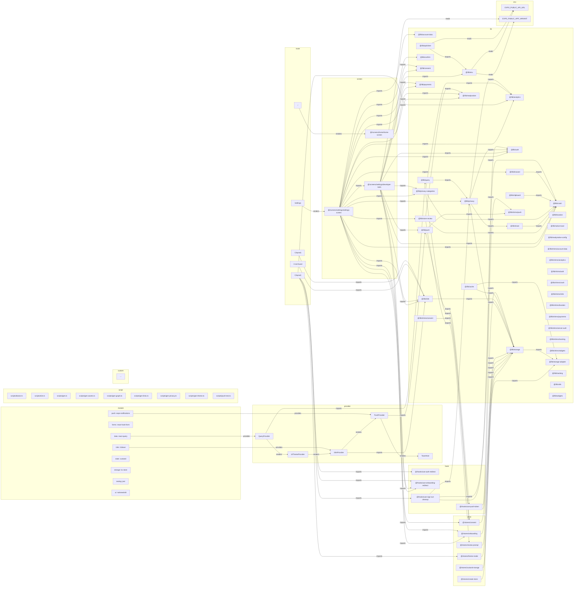

# Architecture

Generated by `bun run gen:graph` - do not edit; add nodes via docs/graph.extra.json or `// @graph` comments.

## Start here

`bun run setup` picked the stack and wrote it down in `.readynative.json`; the providers it
composed are in `src/providers.tsx`, the env keys it needs in `src/lib/env.ts` (`bun run doctor`
tells you which ones are still missing). Every category has a shim in `@/lib/<category>` that
exists whether or not a module is selected, so screens import `@/lib/auth` and never a vendor
SDK. Screen bodies live in `src/screens`, `src/app` only routes to them.

## Map

## module (8)

| id                               | label                    | file |
| -------------------------------- | ------------------------ | ---- |
| `module:data/react-query`        | data: react-query        | -    |
| `module:forms/react-hook-form`   | forms: react-hook-form   | -    |
| `module:i18n/i18next`            | i18n: i18next            | -    |
| `module:push/expo-notifications` | push: expo-notifications | -    |
| `module:state/zustand`           | state: zustand           | -    |
| `module:storage/kv-store`        | storage: kv-store        | -    |
| `module:testing/jest`            | testing: jest            | -    |
| `module:ui/nativewind4`          | ui: nativewind4          | -    |

## provider (5)

| id                         | label           | file                |
| -------------------------- | --------------- | ------------------- |
| `provider:I18nProvider`    | I18nProvider    | `src/providers.tsx` |
| `provider:PushProvider`    | PushProvider    | `src/providers.tsx` |
| `provider:QueryProvider`   | QueryProvider   | `src/providers.tsx` |
| `provider:ToastHost`       | ToastHost       | `src/providers.tsx` |
| `provider:UiThemeProvider` | UiThemeProvider | `src/providers.tsx` |

## route (5)

| id                     | label       | file                          |
| ---------------------- | ----------- | ----------------------------- |
| `route:_layout`        | / (layout)  | `src/app/_layout.tsx`         |
| `route:(tabs)/_layout` | / (layout)  | `src/app/(tabs)/_layout.tsx`  |
| `route:/`              | /           | `src/app/(tabs)/index.tsx`    |
| `route:/+not-found`    | /+not-found | `src/app/+not-found.tsx`      |
| `route:/settings`      | /settings   | `src/app/(tabs)/settings.tsx` |

## screen (3)

| id                                | label                              | file                                       |
| --------------------------------- | ---------------------------------- | ------------------------------------------ |
| `screen:home/home-screen`         | @/screens/home/home-screen         | `src/screens/home/home-screen.tsx`         |
| `screen:settings/developer-tools` | @/screens/settings/developer-tools | `src/screens/settings/developer-tools.tsx` |
| `screen:settings/settings-screen` | @/screens/settings/settings-screen | `src/screens/settings/settings-screen.tsx` |

## hook (4)

| id                             | label                           | file                                   |
| ------------------------------ | ------------------------------- | -------------------------------------- |
| `hook:use-auth-redirect`       | @/hooks/use-auth-redirect       | `src/hooks/use-auth-redirect.ts`       |
| `hook:use-onboarding-redirect` | @/hooks/use-onboarding-redirect | `src/hooks/use-onboarding-redirect.ts` |
| `hook:use-push-token`          | @/hooks/use-push-token          | `src/hooks/use-push-token.ts`          |
| `hook:use-sign-out-cleanup`    | @/hooks/use-sign-out-cleanup    | `src/hooks/use-sign-out-cleanup.ts`    |

## store (6)

| id                      | label                    | file                            |
| ----------------------- | ------------------------ | ------------------------------- |
| `store:consent`         | @/stores/consent         | `src/stores/consent.ts`         |
| `store:create-store`    | @/stores/create-store    | `src/stores/create-store.ts`    |
| `store:onboarding`      | @/stores/onboarding      | `src/stores/onboarding.ts`      |
| `store:review-prompt`   | @/stores/review-prompt   | `src/stores/review-prompt.ts`   |
| `store:theme-mode`      | @/stores/theme-mode      | `src/stores/theme-mode.ts`      |
| `store:zustand-storage` | @/stores/zustand-storage | `src/stores/zustand-storage.ts` |

## lib (40)

| id                       | label                    | file                            |
| ------------------------ | ------------------------ | ------------------------------- |
| `lib:account-data`       | @/lib/account-data       | `src/lib/account-data.ts`       |
| `lib:analytics`          | @/lib/analytics          | `src/lib/analytics.ts`          |
| `lib:api/client`         | @/lib/api/client         | `src/lib/api/client.ts`         |
| `lib:auth`               | @/lib/auth               | `src/lib/auth.ts`               |
| `lib:browser`            | @/lib/browser            | `src/lib/browser.ts`            |
| `lib:cache`              | @/lib/cache              | `src/lib/cache.ts`              |
| `lib:clipboard`          | @/lib/clipboard          | `src/lib/clipboard.ts`          |
| `lib:confirm`            | @/lib/confirm            | `src/lib/confirm.ts`            |
| `lib:consent`            | @/lib/consent            | `src/lib/consent.ts`            |
| `lib:crash`              | @/lib/crash              | `src/lib/crash.ts`              |
| `lib:env`                | @/lib/env                | `src/lib/env.ts`                |
| `lib:i18n`               | @/lib/i18n               | `src/lib/i18n.ts`               |
| `lib:location`           | @/lib/location           | `src/lib/location.ts`           |
| `lib:native-toast`       | @/lib/native-toast       | `src/lib/native-toast.ts`       |
| `lib:payments`           | @/lib/payments           | `src/lib/payments.ts`           |
| `lib:privacy`            | @/lib/privacy            | `src/lib/privacy.ts`            |
| `lib:privacy-categories` | @/lib/privacy-categories | `src/lib/privacy-categories.ts` |
| `lib:push`               | @/lib/push               | `src/lib/push.ts`               |
| `lib:query`              | @/lib/query              | `src/lib/query.tsx`             |
| `lib:readynative`        | @/lib/readynative        | `src/lib/readynative.ts`        |
| `lib:readynative-config` | @/lib/readynative-config | `src/lib/readynative-config.ts` |
| `lib:share`              | @/lib/share              | `src/lib/share.ts`              |
| `lib:shims/account-data` | @/lib/shims/account-data | `src/lib/shims/account-data.ts` |
| `lib:shims/analytics`    | @/lib/shims/analytics    | `src/lib/shims/analytics.ts`    |
| `lib:shims/auth`         | @/lib/shims/auth         | `src/lib/shims/auth.ts`         |
| `lib:shims/consent`      | @/lib/shims/consent      | `src/lib/shims/consent.ts`      |
| `lib:shims/crash`        | @/lib/shims/crash        | `src/lib/shims/crash.ts`        |
| `lib:shims/i18n`         | @/lib/shims/i18n         | `src/lib/shims/i18n.ts`         |
| `lib:shims/location`     | @/lib/shims/location     | `src/lib/shims/location.ts`     |
| `lib:shims/payments`     | @/lib/shims/payments     | `src/lib/shims/payments.ts`     |
| `lib:shims/push`         | @/lib/shims/push         | `src/lib/shims/push.ts`         |
| `lib:shims/server-auth`  | @/lib/shims/server-auth  | `src/lib/shims/server-auth.ts`  |
| `lib:shims/tracking`     | @/lib/shims/tracking     | `src/lib/shims/tracking.ts`     |
| `lib:shims/widgets`      | @/lib/shims/widgets      | `src/lib/shims/widgets.ts`      |
| `lib:storage`            | @/lib/storage            | `src/lib/storage.ts`            |
| `lib:storage-adapter`    | @/lib/storage-adapter    | `src/lib/storage-adapter.ts`    |
| `lib:store-review`       | @/lib/store-review       | `src/lib/store-review.ts`       |
| `lib:tracking`           | @/lib/tracking           | `src/lib/tracking.ts`           |
| `lib:utils`              | @/lib/utils              | `src/lib/utils.ts`              |
| `lib:widgets`            | @/lib/widgets            | `src/lib/widgets.ts`            |

## env (2)

| id                            | label                   | file |
| ----------------------------- | ----------------------- | ---- |
| `env:EXPO_PUBLIC_API_URL`     | EXPO_PUBLIC_API_URL     | -    |
| `env:EXPO_PUBLIC_APP_VARIANT` | EXPO_PUBLIC_APP_VARIANT | -    |

## script (9)

| id                   | label                  | file                     |
| -------------------- | ---------------------- | ------------------------ |
| `script:doctor`      | scripts/doctor.ts      | `scripts/doctor.ts`      |
| `script:e2e`         | scripts/e2e.ts         | `scripts/e2e.ts`         |
| `script:gen`         | scripts/gen.ts         | `scripts/gen.ts`         |
| `script:gen-assets`  | scripts/gen-assets.ts  | `scripts/gen-assets.ts`  |
| `script:gen-graph`   | scripts/gen-graph.ts   | `scripts/gen-graph.ts`   |
| `script:gen-links`   | scripts/gen-links.ts   | `scripts/gen-links.ts`   |
| `script:gen-privacy` | scripts/gen-privacy.ts | `scripts/gen-privacy.ts` |
| `script:gen-theme`   | scripts/gen-theme.ts   | `scripts/gen-theme.ts`   |
| `script:push-test`   | scripts/push-test.ts   | `scripts/push-test.ts`   |

## custom (1)

| id     | label | file                   |
| ------ | ----- | ---------------------- |
| `<id>` | …     | `scripts/gen-graph.ts` |
