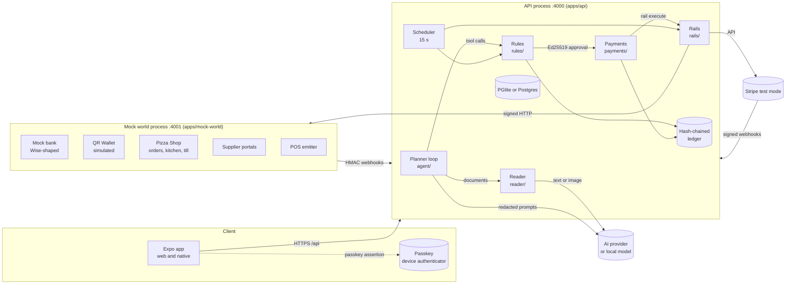
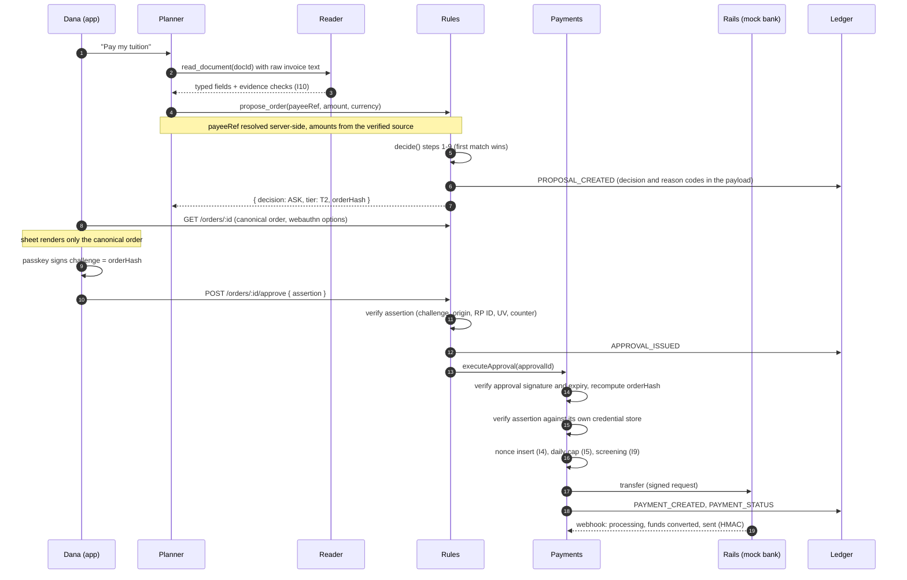

# Architecture

Kassa separates three things that most finance agents mix together: **drafting** (the AI), **deciding** (plain code), and **moving money** (signed approvals only). This document describes the parts, how a request travels through them, the three core algorithms, the data model, and the AI layer. Security controls are in [SECURITY.md](SECURITY.md); privacy in [PRIVACY.md](PRIVACY.md).

Source of truth: [docs/spec/TECH_SPEC.md](spec/TECH_SPEC.md) (how). Deviations are logged with dates in [DECISIONS.md](DECISIONS.md).

## 1. System parts

| Part | Job | Code | Talks to |
| --- | --- | --- | --- |
| App (Expo, web and native) | Chat, confirmation sheet, balances per currency, bills, presets, activity, freeze, passkey prompts | `apps/mobile/src/app/` | API over HTTPS, `@simplewebauthn/browser` on web, `react-native-passkeys` on native |
| Planner (AI agent) | Understands the request, reads tool outputs, compares routes, drafts orders | `apps/api/src/modules/agent/` (loop, tools, redaction, replay) | AI SDK model; rules via `proposeOrder` only |
| Reader (quarantined AI call) | Turns untrusted documents, notifications and emails into typed fields with evidence | `apps/api/src/modules/reader/` | Its own model call; no tools, no memory |
| Rules | Evaluates the hard rules, computes the risk score, builds the canonical order, verifies rules passkeys, signs approvals (Ed25519), runs mandates and rule changes | `apps/api/src/modules/rules/`, `users/`, `mandates/`, `payees/` | Payments (through a registered executor, see 3.2), ledger |
| Payments | Executes only approvals it can verify on its own; own passkey store, own daily cap, single-use nonces, screening for bank transfers | `apps/api/src/modules/payments/` | Rails, ledger, `rules/publicKey` only |
| Rails | Stripe Issuing one-time cards (or `fake`), Stripe PaymentIntents for pay in place, mock bank transfers, QR handoff | `apps/api/src/modules/rails/` | Stripe (sandbox), mock world over signed HTTP |
| Ledger | Append-only, hash-chained record of every proposal, approval, refusal, payment and auth decision; signed checkpoints every 20 entries | `apps/api/src/modules/ledger/` | Everything writes; nothing edits |
| Capture, budget, FX | Parses notifications and Shortcut payloads, deduplicates, categorises, budgets and pace, rates, route optimizer, coverage forecast, fee x-ray | `capture/`, `budget/`, `fx/` | Reader (fallback), ledger |
| Scheduler | 15 s in-process tick on the demo clock: due bills, rule-change and mandate activation, card expiry, bank polling, digests, retention | `apps/api/src/modules/scheduler/` | Rules, payments, rails, privacy |
| Business (pizzerias, Shanghai and Budapest) | Inventory and stock movements, recipes, sales, the stock forecast, purchase orders (draft, passkey signing over `poHash`, send to supplier), supplier webhooks and the invoice three-way match | `apps/api/src/modules/business/` | Rules (`proposeOrder` for a matched invoice), payments re-check, mock world over signed HTTP, ledger |
| Commerce | Shop orders (delivery) and till bills a customer pays through Kassa; status mirrored from signed `shop` webhooks; the merchant's sale recorded once paid | `apps/api/src/modules/commerce/` | Rules, business (`recordSale`), notifications, ledger |
| Mock world | Simulated companies, QR wallet, bank, POS, remittance, pizza shop order book (delivery, kitchen screen, counter till), supplier portals (A to D, D the lookalike), Demo Stage; every outgoing webhook is HMAC-signed | `apps/mock-world/src/` | API webhooks |

Shared contracts live in `packages/shared/src/`: zod schemas, `CanonicalOrder`, `orderHash`, `mandateHash`, reason codes, money formatting, IBAN checks, and the mock webhook signer and verifier.

## 2. Process boundaries



Two processes. The API process holds the database, and the AI agent, rules, payments and rails all run in it. The mock world is a separate process with its own HMAC secret and no database.

**Honest limit (spec §2):** in this build the rules and payments modules run in one process with separate keys and separate credential stores. That protects against logic bugs and against a single stolen key. It does not protect against full compromise of the API process. A production deployment would run rules and payments as separate services with separate hosts.

## 3. Request flows

### 3.1 Tuition payment (tier T2, passkey over the order)



Refusals stop at the first failing step. The result is a ledger entry (`PAYMENT_REFUSED` or a refused decision) and a reason code. No money moves.

### 3.2 How rules hands an approved order to payments

`rules/index.ts` imports nothing from `payments/` (invariant I1 and the import graph). Instead, `orders/wiring.ts` registers an executor at startup with `registerExecutor()`. Rules calls the executor for AUTO orders and for approvals. The payments module imports only `rules/publicKey` from rules, as enforced by `eslint.config.mjs`.

### 3.3 Other flows

| Flow | Path |
| --- | --- |
| Rent on autopay (tier T1) | Scheduler finds an obligation due within 3 days, calls `proposeOrder` with `createdBy=SCHEDULER`. The active mandate matches (decide step 7), so the decision is AUTO. Payments checks the mandate scope and the stored mandate assertion |
| Pizza, one-time card | Planner proposes a `CARD_ISSUING` order. Approval creates a single-use Stripe Issuing card (or the `fake` issuer). The shop checkout calls the issuer's authorization path. The issuer approves only one charge that matches merchant, amount, currency and time |
| Handoff (Shanghai region) | `region = CN` gives decision HANDOFF. The mock QR wallet returns a payee name. The API compares it with the verified payee (similarity at least 0.92). On mismatch the app shows no pay button and no QR |
| Money from home | Mock remittance webhook credits the wallet and creates a notification. The forecast and route optimizer then propose a conversion |
| Capture | Notification, Shortcut or text input goes to a deterministic parser first, then to the Reader. Capture only logs and budgets. It never creates an approval (I6) |
| Shop order and till bill | The app proposes a shop order or a till bill; the amount comes from the shop's server-side price, not the client. After approval the shop charges the one-time card (or the region CN QR handoff is paid). The shop's signed `shop` webhooks (kind `shop`) move the order forward only (RECEIVED, ACCEPTED, COOKING, OUT_FOR_DELIVERY, DELIVERED; till: PAID); the merchant's sale lowers stock by recipe once |
| Restock (purchase order) | The forecast tick (scheduler job `business.forecastTick`) or the business agent drafts a PO from a VERIFIED supplier (I6: a draft, nothing payable). The owner signs it with the payments passkey: challenge = `poHash` of the core the server rebuilds from the stored draft. Kassa sends it to the supplier HMAC-signed; the supplier's signed `supplier` webhooks report confirmed, delivered (stock receipt) and invoiced |
| Invoice three-way match | `business/invoices.ts`: invoice supplier = PO supplier, invoice account hash = the signed core's `supplierAccountHash` = the verified payee's current hash, amount ≤ signed total. A miss is `INVOICE_ACCOUNT_MISMATCH` or `INVOICE_ABOVE_PO` (ledger `INVOICE_REFUSED`, owner notified, no proposal). A match creates one obligation and proposes its payment (always ASK T2, or HANDOFF in region CN; `PO_NOT_DELIVERED` if goods have not arrived) |
| Payments re-check for a PO | **Invariant:** payments never trusts the business module. For an order carrying `purchaseOrderId` it recomputes `poHash` from the stored core, re-verifies the owner's stored passkey assertion over it, and checks payee = the PO's supplier and signed account, amount ≤ signed total, PO not already paid (`payments/index.ts` `verifyPurchaseOrder`; `BAD_SIGNATURE`, `INVOICE_ACCOUNT_MISMATCH`, `INVOICE_ABOVE_PO`) |

## 4. Core algorithms

Each algorithm has the formula, pseudocode, code location and the tests that exercise it. Money is in integer minor units with an ISO 4217 code; rates are decimal strings converted to rationals (`fx/rational.ts`), with one HALF_UP rounding to minor units.

### 4.1 Route and FX optimizer: cheapest way to fund a bill

For a bill of amount A in currency `to`, due on date d, and funding balances per currency, each candidate route is a pair (funding currency f, rail r) from `fixtures/rails.json`.

$$
\text{cost}_{r,f} = \text{toHome}\big(\text{fee}_r\big) + \text{toHome}\big(A_f \cdot \tfrac{\text{markupBps}_r}{10\,000}\big), \qquad A_f = A \cdot \text{rate}(\text{to} \to f)
$$

A route is kept only if it arrives by the due date, the funding balance covers the total debit (amount, markup and fee), and the rail cap holds. Same-currency routes have no markup term.

```text
routes = []
for each funding currency f with a balance:
  for each rail r that supports f and the target currency:
    arrival = today + settlementDays(r) business days
    if due date exists and arrival > due: skip
    A_f = convert(A, to -> f) if f != to else A
    markup_f = applyBps(A_f, markupBps(r)) if f != to else 0
    fee_f = convert(feeFixed(r), feeCurrency -> f)
    if A_f + markup_f + fee_f > balance[f]: skip          (balance cap)
    if A_f > maxAmount(r): skip                           (rail cap)
    cost = toHome(feeFixed(r)) + toHome(markup_f)
    routes += (r, f, arrival, cost)
sort routes by cost, then arrival, then routeId (deterministic)
return top 3, each with savingsVsWorst = worstCost - cost
```

**Deviation from the build plan:** the build plan's formula adds a term `P(late) × penalty`. The implementation does not model late-arrival probability. Routes that arrive after the due date are discarded instead. The savings figure is shown in the home currency.

Code: `apps/api/src/modules/fx/routes.ts` (`getRoutes`), `fx/rails.ts` (rail profiles), `fx/rates.ts` (rate sources), `fx/rational.ts`.
Tests: `apps/api/test/intel/fx-routes.test.ts` (9 tests: rail loading, tuition example, same-currency and empty balances), `apps/api/test/intel/fx-rates.test.ts` (18 tests: rational arithmetic, dates, offline fixture table, stubbed online sources, NBK XML parsing).

Rate sources, in order: ECB via Frankfurter (`https://api.frankfurter.dev/v1/{date}`), National Bank of Kazakhstan for KZT (`nationalbank.kz` daily rates), open.er-api.com as a labelled fallback, and `fixtures/fx-rates.json` as a labelled `STATIC_EXAMPLE` (also used with `FX_OFFLINE=1` or `NODE_ENV=test`). Every quote carries its `source`. Rates are looked up for the purchase date with a ±1 business-day tolerance.

### 4.2 Cash-flow coverage forecast

For each currency k and each day t in 0..45:

$$
B_k(t) = B_k(0) + \sum_{\text{income}_k \le t} x - \sum_{\text{bill}_k \le t} x - \text{burn}_k \cdot t
$$

`burn_k` is the median daily spend in k over the last 30 days, with days without spend counted as zero. The first day with `B_k(t) < reserve_k` is a shortfall. The suggestion is the cheapest conversion from a currency with surplus, found with 4.1.

```text
for each currency k in balances, incomes, obligations:
  flows = balance[k]
  burn = median(daily spend in k over last 30 days, zeros included)
  for t in 0..45:
    flows += incomes(k, day t) - bills(k, day t)
    B = flows - burn * t
    if B < reserve[k] and no shortfall yet: shortfall = (day t, reserve - B)
  suggestions = cheapest route from a surplus currency (4.1) covering each shortfall
```

Code: `apps/api/src/modules/fx/forecast.ts` (`projectBalances`, `computeForecast`, `burnRate`, `occurrences`, `addMonths`).
Tests: `apps/api/test/intel/forecast-fees.test.ts` (18 tests across forecast helpers, `projectBalances` and `computeForecast`).

### 4.3 Fee x-ray (card markup)

On settlement of a foreign charge, the fee is the settled home amount minus the mid-market home amount:

$$
\text{feeHome} = \text{settledHome} - A_{\text{orig}} \cdot \text{mid}(d), \qquad \text{markupBps} = \frac{\text{feeHome}}{A_{\text{orig}} \cdot \text{mid}(d)} \cdot 10\,000
$$

Per card, a rolling median over the last 20 settled samples is kept. The best card for a purchase minimises `markupBps × amount / 10 000 + fixedFee`. A dynamic-currency-conversion flag is raised when a foreign purchase is charged in the home currency and the charge is more than 200 bps above mid.

Code: `apps/api/src/modules/fx/fees.ts` (`settlementFee`, `rollingMedianBps`, `bestCard`, `dccFlag`).
Tests: `apps/api/test/intel/forecast-fees.test.ts` (`settlementFee`, `rollingMedianBps`, `bestCard`, `dccFlag`), `apps/api/test/intel/integration.test.ts` (capture, dedupe, budget notification and settlement fee x-ray end to end).

### 4.4 Risk score: when to ask the human

The score is plain code. The AI's own confidence never lowers it. The AI can add a question (`agentRequestedConfirm`), never remove one.

$$
R = \sum_i w_i \, f_i, \qquad f_i \in [0,1], \qquad \sum_i w_i = 1
$$

| Feature | Value (f) | Weight |
| --- | --- | --- |
| `newMerchant` | 1 if no prior payment to this payee, else 0 | 0.30 |
| `budgetShare` | min(1, amount / category remaining); 1 if remaining ≤ 0 | 0.20 |
| `priceAboveMedian` | min(1, (unit price / median − 1) / 0.5), worst item | 0.15 |
| `quantityVsHistory` | min(1, \|qty − median\| / median), worst item | 0.10 |
| `triggerOrigin` | 1 if created by scheduler or trigger | 0.10 |
| `readerUnverifiedNonCritical` | 1 if a non-critical Reader field is unverified | 0.10 |
| `unusualHour` | 1 if local time is 00:00 to 06:00 | 0.05 |

The result is rounded to 4 decimal places. Thresholds depend on the preset: Ask me always asks, Smart asks at R ≥ 0.5, Autopilot asks outside a mandate.

```text
features = riskFeatures(order, history, budgets, localHour, origin, readerFlags)
R = round4(sum over i of weight[i] * clamp01(features[i]))
```

Code: `apps/api/src/modules/rules/risk.ts` (`riskFeatures`, `riskScore`, `median`), `rules/riskWeights.ts` (weights, `SMART_RISK_THRESHOLD = 0.5`), used by `rules/decide.ts`.
Tests: `apps/api/test/rules/risk.test.ts` (16 tests: median, weights sum, feature values, score rounding), `apps/api/test/rules/decide.test.ts` (39 tests, including "SMART at risk 0.5 asks with RISK_HIGH" and "SMART at risk 0.49 is AUTO").

### 4.5 Decision order (rules engine)

`decide()` is pure. All facts are gathered first (`rules/facts.ts`). First match wins:

| Step | Condition | Result |
| --- | --- | --- |
| 1 | User frozen | REFUSE (`REFUSE_FROZEN`) |
| 2 | Payee missing, blocked, or cooling before `coolingUntil` | REFUSE (`REFUSE_UNVERIFIED_PAYEE`). Cooling after the window is usable only with a passkey (ASK, `PAYEE_COOLING`) |
| 3 | Reader marks amount or account unverified | REFUSE (`REFUSE_SOURCE_MISMATCH`) |
| 4 | Screening hit on a bank transfer | REFUSE (`REFUSE_SANCTIONS`) |
| 5 | Per-payment, daily or monthly cap, or reserve breached | REFUSE (`REFUSE_CAP`). Smart turns this into ASK when the amount is within 2× the cap and the reserve is not breached |
| 6 | Region CN, or money mode HANDOFF | HANDOFF |
| 7 | Active, effective mandate covers the order, and preset is not Ask me | AUTO (T1) |
| 8 | Ask me; Autopilot without mandate; Smart with R ≥ 0.5 | ASK (T2) |
| 9 | Smart, verified payee, capped wallet, rail card or bank transfer, passkey-signed base rules, amount within small-auto limit | AUTO (T1, `SMALL_AUTO`). Otherwise ASK |

Informational flags are appended to non-refusals: `MANDATE_OUT_OF_SCOPE`, `TRIGGER_ORIGIN`, `READER_FIELD_UNVERIFIED`.

## 5. Canonical order and approvals

```text
CanonicalOrder = { v, proposalId, userId, payeeId, payeeName, payeeAccountHash,
                   amountMinor, currency, rail, purpose, homeAmountMinor, homeCurrency,
                   mandateId | null, nonce, expiresAt }      // packages/shared/src/order.ts
orderHash = base64url(sha256(utf8(JCS(order))))              // RFC 8785 JCS, RFC 4648 section 5
```

- The WebAuthn challenge for a T2 approval **is** the `orderHash` (I3).
- The rules module verifies the assertion, then signs an approval `{orderHash, tier, issuedAt, expiresAt = +5 min, keyId}` with Ed25519 (`RULES_SIGNING_KEY`, RFC 8032) over `JCS(approval)` (`rules/signing.ts`).
- The payments module recomputes `orderHash` from the stored canonical order and checks the approval signature with `RULES_PUBLIC_KEY` (`payments/index.ts`).
- Expired pending orders are re-issued with a new nonce, expiry and hash. The old hash can never be approved.
- The app recomputes the hash before any passkey prompt and refuses to sign on a mismatch (defence in depth, `DECISIONS.md` 2026-10-11).

Golden vectors for `orderHash` and `mandateHash` are committed in `packages/shared/test/order.test.ts` and `packages/shared/test/mandate.test.ts`.

## 6. Data model

Tables are defined in `apps/api/src/db/schema.ts` (spec §6, plus additions) and `apps/api/src/db/schema.intel.ts` (agent and capture tables). Migrations: `apps/api/drizzle/0000_init.sql` (the base schema), `0001_security_privacy.sql` (consent, restriction, erasure columns, PAN reference rewrite), and any later numbered files in that folder.

| Group | Tables | Notes |
| --- | --- | --- |
| Identity and keys | `users`, `user_keys`, `webauthn_credentials_rules`, `webauthn_credentials_payments`, `devices` | Two credential tables, written separately. `user_keys` holds a per-user data key wrapped with `USER_KEK` |
| Profile and rules | `profiles`, `rule_changes`, `mandates`, `budgets`, `obligations`, `payees` | Caps and base rules live in `profiles`. Payee account details are AES-256-GCM encrypted (`accountEnc`), with `accountHash` for comparison |
| Money | `cards`, `card_fee_profiles`, `transactions`, `issued_cards`, `payments` | `transactions` holds captured spending and its fee reconciliation. `payments` has `status` in CREATED, PROCESSING, SENT, FAILED, CANCELED |
| Orders | `proposals`, `approvals`, `used_nonces` | `proposals.canonical_order` is the signed object. `used_nonces` has the nonce as primary key |
| Ledger | `ledger_entries`, `ledger_checkpoints` | `prev_hash` and `hash` per entry; checkpoint every 20 entries |
| Agent and capture | `agent_messages`, `agent_documents`, `placeholder_maps`, `merchant_category_memory`, `onboarding_drafts` | Redacted history only. `placeholder_maps` is server-side. Uploaded documents are cached with their Reader result |
| Business and commerce | `merchants`, `inventory_items`, `recipes`, `supplier_items`, `sales_daily`, `stock_movements`, `purchase_orders`, `shop_orders` | Stock on hand is the sum of `stock_movements`. `purchase_orders` stores the signed `core`, `poHash` (unique) and the owner assertion; `shop_orders` mirrors the shop's status timeline |
| Demo and notices | `notifications`, `demo_state` | Demo clock offset and agent mode |

## 7. AI layer

### 7.1 Provider-agnostic model registry

Models are addressed as `provider:model` in `PLANNER_MODEL` and `READER_MODEL`. The registry is built on the Vercel AI SDK (`ai`) provider registry (`apps/api/src/modules/ai/registry.ts`). Providers: `anthropic`, `openai`, `google`, and `local` (any OpenAI-compatible endpoint, for example Ollama or LM Studio). The registry splits on the first `:`, so `local:llama3.1:8b` is valid.

Providers that do not support tool calling or image input return an error code for the affected feature (for example `AI_VISION_UNSUPPORTED`). The spec named the Anthropic SDK directly; the AI SDK was chosen so that providers can change without code changes (`DECISIONS.md`, 2026-10-10).

### 7.2 Planner loop

- Up to 8 tool rounds per user turn, then one text-only step (`MAX_TOOL_STEPS = 8`, `apps/api/src/modules/agent/tools.ts`).
- Eleven tools (`apps/api/src/modules/agent/tools.ts`, schemas in `packages/shared/src/tools.ts`): `get_profile_summary`, `get_balances`, `get_budget`, `get_obligations`, `get_payee_facts`, `search_catalog`, `get_routes`, `forecast_coverage`, `read_document`, `propose_order`, `log_expense`. `propose_order` is the only tool that writes, and it writes a proposal, not a payment. `log_expense` only logs.
- When a tool returns REFUSE or a cooling payee, the next step runs with no tools so the agent can explain, and the loop stops.
- Every model call sees redacted messages only (section 7.4).

### 7.3 Replay mode

`AGENT_MODE=REPLAY` (or the demo panel toggle) serves recorded model steps from `fixtures/agent-recordings/<scenario>.json` through the AI SDK mock model. Only model outputs are recorded. Tools run for real in replay, so balances, rules and the ledger are live. Reader extractions are recorded separately under `fixtures/agent-recordings/reader/<key>.json` and are re-verified against the source on replay. `RECORD=1` (live only) writes new recordings.

The planner's behaviour in replay is therefore fixed, which is what makes the demo repeatable. It is not evidence about live model quality.

### 7.4 Reader and redaction

- **Reader (I10):** one model call with no tools, no memory, and forced structured output. The Reader's fields are checked on the server: each `evidence` string must appear in the extracted source text, and numbers are re-parsed from the evidence (`reader/evidence.ts`). Failures become `UNVERIFIED`, and amount or account failures become `READER_SOURCE_MISMATCH`.
- **Redaction (I11):** `agent/redact.ts` replaces IBANs, card numbers (Luhn-checked), email addresses, phone numbers (E.164) and personal names with stable placeholders per conversation. `agent/middleware.ts` applies this to every planner input and tool result. Enum and code fields are never redacted. `propose_order` resolves placeholders on the server.
- **Display:** the app shows names and masked accounts (`HU…1234`, `•••• 1234`). The planner never sees them.

## 8. Clock and demo

`Clock.now() = realNow + demo_state.clockOffsetMs` (`apps/api/src/modules/clock/`). Every expiry, cooling window, due date, token lifetime and webhook window uses it. The demo can advance the clock by hours or days, which triggers the scheduler. The seed story time is `2026-10-27T09:00:00Z`, four to five days before the tuition and rent due dates, so the "+3 days" demo step falls inside the rent scheduling window.

## 9. Code map

| Module | Entry points |
| --- | --- |
| `apps/api/src/server.ts` | Fastify app, error handler, route registration under `/api` |
| `apps/api/src/index.ts` | Process entry point, scheduler start, graceful shutdown |
| `apps/api/src/http/` | `security.ts` (deny by default, rate limits, headers, CORS, body limits), `audit.ts`, `problem.ts` (RFC 9457) |
| `apps/api/src/modules/auth/` | Passkey registration and login, sessions (`session.ts`), single-use challenges (`challenges.ts`) |
| `apps/api/src/modules/rules/` | `decide.ts`, `facts.ts`, `index.ts` (`proposeOrder`, `approveOrder`, `getOrderView`), `webauthn.ts`, `signing.ts`, `risk.ts` |
| `apps/api/src/modules/payments/` | `index.ts` (`executeApproval`), `credentials.ts`, `mandateScope.ts`, `status.ts`, `routes.ts` |
| `apps/api/src/modules/rails/` | `issuing.ts`, `mockBank.ts`, `handoff.ts`, `payInPlace.ts`, `http.ts` (signed calls to the mock world) |
| `apps/api/src/modules/ledger/` | `internal.ts` (hash chain, checkpoints, verification), `keys.ts`, `index.ts` |
| `apps/api/src/modules/privacy/` | Export, erasure, restriction, consent, AI notice, retention (`service.ts`), per-user keys (`keys.ts`) |
| `apps/api/src/modules/webhooks/` | Mock HMAC webhooks, fake issuing authorization, Stripe webhook |
| `apps/api/src/modules/scheduler/` | 15 s tick and job list |
| `apps/api/src/modules/business/` | `forecast.ts` (pure), `scheduler.ts` (forecast tick), `drafts.ts`, `sign.ts`, `supplier.ts`, `invoices.ts` (three-way match), `routes.ts` |
| `apps/api/src/modules/commerce/` | `service.ts` (shop order status), `bills.ts` (till), `fulfill.ts`, `routes.ts` |
| `apps/mock-world/src/` | `app.ts`, `routes/` (bank, documents, events, QR, shop, shopOrders, supplierPortal, stage), `shop/` (order book, issuer), `supplier/` (PO book, swapped-invoice attack), `stage/` (Demo Stage pages), `bank/`, `qr/` (EMVCo payload), `pdf/` (invoices), `world/data.ts` |
| `packages/shared/src/` | `order.ts`, `mandate.ts`, `jcs.ts`, `reasonCodes.ts`, `money.ts`, `iban.ts`, `fxMath.ts`, `webhookHmac.ts`, `dto.ts`, `appDto.ts`, `intelDto.ts`, `privacyDto.ts` |

## 10. Standards used

| Area | Standard |
| --- | --- |
| Money | ISO 4217 currency exponents; integers only (no floats for money) |
| Time | ISO 8601 and RFC 3339, UTC |
| Accounts | ISO 13616 (IBAN), ISO 7064 MOD 97-10, ISO 11649 (RF creditor references). BIC (ISO 9362) is not validated in this build |
| Merchants | ISO 18245 (MCC) |
| Canonicalisation and hashing | RFC 8785 (JCS), SHA-256, RFC 4648 section 5 (base64url) |
| Signatures | RFC 8032 (Ed25519), RFC 2104 (HMAC-SHA256 for webhooks), W3C WebAuthn Level 3 |
| Sessions | RFC 7519 (JWT), RFC 9700 (refresh token rotation) |
| Errors | RFC 9457 (problem details) |
| Encryption | NIST SP 800-38D (AES-GCM), RFC 5869 (HKDF for the PAN reference key) |

The full list, with the reasoning, is in `DECISIONS.md` (standards-first rule, 2026-10-10).

## 11. Known deviations from the spec

| Spec | Built | Reason | Log |
| --- | --- | --- | --- |
| pnpm | bun workspaces with Turborepo | The Expo boilerplate is bun-native | DECISIONS 2026-10-10 |
| Anthropic SDK | Vercel AI SDK provider registry | Provider change without code changes, replay independent of vendor | DECISIONS 2026-10-10 |
| `agentMode` preset switch | `agentAutonomy` | Name clash with the demo `agentMode` | DECISIONS 2026-10-10 |
| Native app from scratch | Expo app generated from ReadyNative Pro | Time before the feature freeze | DECISIONS 2026-10-10 (licence resolved 2026-10-12, see LICENSE) |
| `PAYMENTS_DAILY_CAP_HOME_MINOR` 50,000,000 | 200,000,000 | The hero tuition would always be refused | DECISIONS 2026-10-11 |
| `PAYMENTS_DAILY_CAP_CURRENCY` | KZT | Reference currency of the cap; converted to each home currency, rounded down (fail closed) | DECISIONS 2026-10-12 |
| Route cost with late-arrival penalty | Late routes excluded, no penalty term | Simpler and deterministic | Section 4.1 |
| Single Postgres | PGlite by default, Postgres when `DATABASE_URL` is set | No Docker needed for local use | DECISIONS 2026-10-11 |

Known limitations of the current build are listed in [SECURITY.md](SECURITY.md), section 7.
