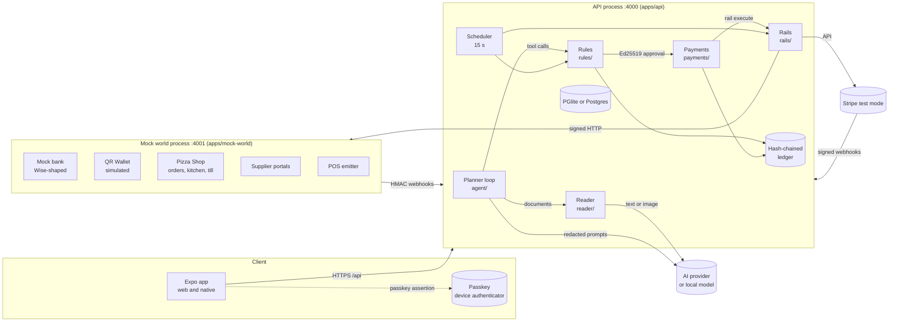
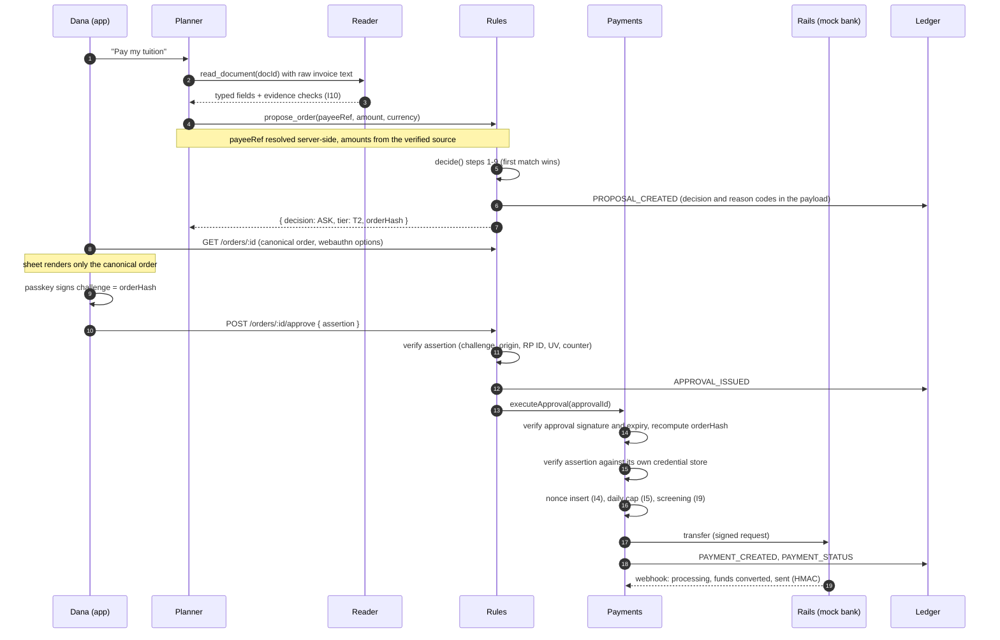

# Architecture

Kassa separates **drafting** (the AI), **deciding** (plain code) and **moving money** (signed approvals only). Security: [security/self-assessment.md](../security/self-assessment.md). Privacy: [security/privacy.md](../security/privacy.md). Pre-build spec: [tech-spec.md](./tech-spec.md); dated deviations: [decisions.md](./decisions.md).

## 1. System parts

| Part | Job | Code | Talks to |
| --- | --- | --- | --- |
| App (Expo, web and native) | Chat, confirmation sheet, balances, bills, presets, activity, freeze, passkeys | `apps/mobile/src/app/` | API over HTTPS, `@simplewebauthn/browser` on web, `react-native-passkeys` on native |
| Planner (AI agent) | Reads tool outputs, compares routes, drafts orders | `apps/api/src/modules/agent/` (loop, tools, redaction, replay) | AI SDK model; rules via `proposeOrder` only |
| Reader (quarantined AI call) | Untrusted documents, notifications, emails → typed fields with evidence | `apps/api/src/modules/reader/` | Its own model call; no tools, no memory |
| Rules | Hard rules, risk score, canonical order, rules passkey check, Ed25519 approvals, mandates, rule changes | `apps/api/src/modules/rules/`, `users/`, `mandates/`, `payees/` | Payments (through a registered executor, see 3.2), ledger |
| Payments | Executes only approvals it verifies itself; own passkey store, own daily cap, single-use nonces, screening | `apps/api/src/modules/payments/` | Rails, ledger, `rules/publicKey` only |
| Rails | Stripe Issuing one-time cards (or `fake`), PaymentIntents (pay in place), mock bank transfers, QR handoff | `apps/api/src/modules/rails/` | Stripe (sandbox), mock world over signed HTTP |
| Ledger | Append-only hash chain of every proposal, approval, refusal, payment and auth decision; signed checkpoint every 20 entries | `apps/api/src/modules/ledger/` | Everything writes; nothing edits |
| Capture, budget, FX | Parse, dedupe, categorise; budgets and pace; rates, route optimizer, coverage forecast, fee x-ray | `capture/`, `budget/`, `fx/` | Reader (fallback), ledger |
| Scheduler | 15 s tick on the demo clock: due bills, rule-change and mandate activation, card expiry, bank polling, digests, retention | `apps/api/src/modules/scheduler/` | Rules, payments, rails, privacy |
| Business (pizzerias, Shanghai and Budapest) | Inventory, recipes, sales, stock forecast, purchase orders (draft, passkey over `poHash`, send), supplier webhooks, invoice three-way match | `apps/api/src/modules/business/` | Rules (`proposeOrder` for a matched invoice), payments re-check, mock world over signed HTTP, ledger |
| Commerce | Shop orders (delivery) and till bills paid through Kassa; status from signed `shop` webhooks; merchant sale recorded once paid | `apps/api/src/modules/commerce/` | Rules, business (`recordSale`), notifications, ledger |
| Mock world | Simulated companies, QR wallet, bank, POS, remittance, pizza shop (delivery, kitchen, till), supplier portals (A to D, D the lookalike), Demo Stage; all webhooks HMAC-signed | `apps/mock-world/src/` | API webhooks |

Shared contracts (`packages/shared/src/`): zod schemas, `CanonicalOrder`, `orderHash`, `mandateHash`, reason codes, money formatting, IBAN checks, and the mock webhook signer and verifier.

## 2. Process boundaries



Two processes. The API process holds the database, agent, rules, payments and rails. The mock world has its own HMAC secret and no database.

**Honest limit (spec §2):** rules and payments share one process, with separate keys and credential stores. This stops logic bugs and a single stolen key, not full compromise of the API process. Production would run them as separate services on separate hosts.

## 3. Request flows

### 3.1 Tuition payment (tier T2, passkey over the order)



Refusals stop at the first failing step with a ledger entry (`PAYMENT_REFUSED` or a refused decision) and a reason code. No money moves.

### 3.2 How rules hands an approved order to payments

`rules/index.ts` imports nothing from `payments/` (I1). `orders/wiring.ts` registers an executor at startup (`registerExecutor()`), which rules calls for AUTO orders and approvals. Payments imports only `rules/publicKey` from rules (`eslint.config.mjs`).

### 3.3 Other flows

| Flow | Path |
| --- | --- |
| Rent on autopay (tier T1) | Scheduler finds a bill due within 3 days, calls `proposeOrder` (`createdBy=SCHEDULER`). The mandate matches (step 7): AUTO. Payments checks mandate scope and the stored mandate assertion |
| Pizza, one-time card | Planner proposes a `CARD_ISSUING` order. Approval creates a single-use Stripe Issuing (or `fake`) card. The issuer approves only one charge matching merchant, amount, currency and time |
| Handoff (Shanghai region) | `region = CN` → HANDOFF. The QR wallet's payee name must match the verified payee (similarity ≥ 0.92); on mismatch, no pay button and no QR |
| Money from home | Remittance webhook credits the wallet and notifies; forecast and route optimizer propose a conversion |
| Capture | Notification, Shortcut or text → deterministic parser, then Reader. Only logs and budgets; never an approval (I6) |
| Shop order and till bill | Amount from the shop's server-side price, not the client. After approval the shop charges the one-time card (or the CN QR handoff is paid). Signed `shop` webhooks only move the order forward (RECEIVED, ACCEPTED, COOKING, OUT_FOR_DELIVERY, DELIVERED; till: PAID); the sale lowers stock by recipe once |
| Restock (purchase order) | `business.forecastTick` or the business agent drafts a PO from a VERIFIED supplier (I6: nothing payable). The owner signs with the payments passkey: challenge = `poHash` of the core rebuilt from the stored draft. Sent HMAC-signed; signed `supplier` webhooks report confirmed, delivered (stock receipt), invoiced |
| Invoice three-way match | `business/invoices.ts`: invoice supplier = PO supplier, invoice account hash = the signed core's `supplierAccountHash` = the verified payee's current hash, amount ≤ signed total. A miss is `INVOICE_ACCOUNT_MISMATCH` or `INVOICE_ABOVE_PO` (ledger `INVOICE_REFUSED`, owner notified, no proposal). A match creates one obligation and proposes payment (ASK T2, or HANDOFF in CN; `PO_NOT_DELIVERED` if goods have not arrived) |
| Payments re-check for a PO | **Invariant:** payments never trusts the business module. For a `purchaseOrderId` order it recomputes `poHash`, re-verifies the owner's assertion, and checks payee = PO supplier and signed account, amount ≤ signed total, PO not already paid (`payments/index.ts` `verifyPurchaseOrder`; `BAD_SIGNATURE`, `INVOICE_ACCOUNT_MISMATCH`, `INVOICE_ABOVE_PO`) |

## 4. Core algorithms

Money is integer minor units with an ISO 4217 code; rates are decimal strings turned into rationals (`fx/rational.ts`), with one HALF_UP rounding to minor units.

### 4.1 Route and FX optimizer: cheapest way to fund a bill

Bill A in currency `to`, due date d. Each route is a pair (funding currency f, rail r) from `fixtures/rails.json`.

$$
\text{cost}_{r,f} = \text{toHome}\big(\text{fee}_r\big) + \text{toHome}\big(A_f \cdot \tfrac{\text{markupBps}_r}{10\,000}\big), \qquad A_f = A \cdot \text{rate}(\text{to} \to f)
$$

Kept only if it arrives by the due date, the balance covers amount + markup + fee, and the rail cap holds. Same-currency routes have no markup.

```text
routes = []
for each funding currency f with a balance:
  for each rail r that supports f and the target currency:
    arrival = today + settlementDays(r) business days
    if due date exists and arrival > due: skip
    A_f = convert(A, to -> f) if f != to else A
    markup_f = applyBps(A_f, markupBps(r)) if f != to else 0
    fee_f = convert(feeFixed(r), feeCurrency -> f)
    if A_f + markup_f + fee_f > balance[f]: skip          (balance cap)
    if A_f > maxAmount(r): skip                           (rail cap)
    cost = toHome(feeFixed(r)) + toHome(markup_f)
    routes += (r, f, arrival, cost)
sort routes by cost, then arrival, then routeId (deterministic)
return top 3, each with savingsVsWorst = worstCost - cost
```

**Deviation:** the planned formula had a `P(late) × penalty` term. Instead, late routes are discarded. Savings are shown in the home currency.

Code: `apps/api/src/modules/fx/routes.ts` (`getRoutes`), `fx/rails.ts` (rail profiles), `fx/rates.ts` (rate sources), `fx/rational.ts`.
Tests: `apps/api/test/intel/fx-routes.test.ts` (9 tests: rail loading, tuition example, same-currency and empty balances), `apps/api/test/intel/fx-rates.test.ts` (18 tests: rational arithmetic, dates, offline fixture table, stubbed online sources, NBK XML parsing).

Rate sources, in order: ECB via Frankfurter (`https://api.frankfurter.dev/v1/{date}`), National Bank of Kazakhstan for KZT (`nationalbank.kz` daily rates), open.er-api.com as a labelled fallback, and `fixtures/fx-rates.json` as a labelled `STATIC_EXAMPLE` (also used with `FX_OFFLINE=1` or `NODE_ENV=test`). Every quote carries its `source`. Rates are looked up for the purchase date with a ±1 business-day tolerance.

### 4.2 Cash-flow coverage forecast

For each currency k and each day t in 0..45:

$$
B_k(t) = B_k(0) + \sum_{\text{income}_k \le t} x - \sum_{\text{bill}_k \le t} x - \text{burn}_k \cdot t
$$

`burn_k` = median daily spend in k over 30 days (zero days included). The first day with `B_k(t) < reserve_k` is a shortfall; the suggestion is the cheapest conversion from a surplus currency (4.1).

```text
for each currency k in balances, incomes, obligations:
  flows = balance[k]
  burn = median(daily spend in k over last 30 days, zeros included)
  for t in 0..45:
    flows += incomes(k, day t) - bills(k, day t)
    B = flows - burn * t
    if B < reserve[k] and no shortfall yet: shortfall = (day t, reserve - B)
  suggestions = cheapest route from a surplus currency (4.1) covering each shortfall
```

Code: `apps/api/src/modules/fx/forecast.ts` (`projectBalances`, `computeForecast`, `burnRate`, `occurrences`, `addMonths`).
Tests: `apps/api/test/intel/forecast-fees.test.ts` (18 tests across forecast helpers, `projectBalances` and `computeForecast`).

### 4.3 Fee x-ray (card markup)

On settlement of a foreign charge:

$$
\text{feeHome} = \text{settledHome} - A_{\text{orig}} \cdot \text{mid}(d), \qquad \text{markupBps} = \frac{\text{feeHome}}{A_{\text{orig}} \cdot \text{mid}(d)} \cdot 10\,000
$$

Per card: rolling median of the last 20 settled samples. Best card minimises `markupBps × amount / 10 000 + fixedFee`. DCC flag: foreign purchase charged in the home currency at more than 200 bps above mid.

Code: `apps/api/src/modules/fx/fees.ts` (`settlementFee`, `rollingMedianBps`, `bestCard`, `dccFlag`).
Tests: `apps/api/test/intel/forecast-fees.test.ts` (`settlementFee`, `rollingMedianBps`, `bestCard`, `dccFlag`), `apps/api/test/intel/integration.test.ts` (capture, dedupe, budget notification and settlement fee x-ray end to end).

### 4.4 Risk score: when to ask the human

Plain code. The AI can add a question (`agentRequestedConfirm`), never remove one or lower the score.

$$
R = \sum_i w_i \, f_i, \qquad f_i \in [0,1], \qquad \sum_i w_i = 1
$$

| Feature | Value (f) | Weight |
| --- | --- | --- |
| `newMerchant` | 1 if no prior payment to this payee, else 0 | 0.30 |
| `budgetShare` | min(1, amount / category remaining); 1 if remaining ≤ 0 | 0.20 |
| `priceAboveMedian` | min(1, (unit price / median − 1) / 0.5), worst item | 0.15 |
| `quantityVsHistory` | min(1, \|qty − median\| / median), worst item | 0.10 |
| `triggerOrigin` | 1 if created by scheduler or trigger | 0.10 |
| `readerUnverifiedNonCritical` | 1 if a non-critical Reader field is unverified | 0.10 |
| `unusualHour` | 1 if local time is 00:00 to 06:00 | 0.05 |

Rounded to 4 decimals. Ask me always asks; Smart asks at R ≥ 0.5; Autopilot asks outside a mandate.

```text
features = riskFeatures(order, history, budgets, localHour, origin, readerFlags)
R = round4(sum over i of weight[i] * clamp01(features[i]))
```

Code: `apps/api/src/modules/rules/risk.ts` (`riskFeatures`, `riskScore`, `median`), `rules/riskWeights.ts` (weights, `SMART_RISK_THRESHOLD = 0.5`), used by `rules/decide.ts`.
Tests: `apps/api/test/rules/risk.test.ts` (16 tests: median, weights sum, feature values, score rounding), `apps/api/test/rules/decide.test.ts` (39 tests, including "SMART at risk 0.5 asks with RISK_HIGH" and "SMART at risk 0.49 is AUTO").

### 4.5 Decision order (rules engine)

`decide()` is pure; facts are gathered first (`rules/facts.ts`). First match wins:

| Step | Condition | Result |
| --- | --- | --- |
| 1 | User frozen | REFUSE (`REFUSE_FROZEN`) |
| 2 | Payee missing, blocked, or cooling before `coolingUntil` | REFUSE (`REFUSE_UNVERIFIED_PAYEE`). Cooling after the window is usable only with a passkey (ASK, `PAYEE_COOLING`) |
| 3 | Reader marks amount or account unverified | REFUSE (`REFUSE_SOURCE_MISMATCH`) |
| 4 | Screening hit, on every rail (bank transfer, card, wallet, QR) | REFUSE (`REFUSE_SANCTIONS`) |
| 5 | Per-payment, daily or monthly cap, or reserve breached | REFUSE (`REFUSE_CAP`) under every preset, never ASK ("within 2× the cap" ask removed 2026-10-14, decisions.md). To pay more, raise the cap with the passkey |
| 6 | Region CN, or money mode HANDOFF | HANDOFF |
| 7 | Active, effective mandate covers the order, and preset is not Ask me | AUTO (T1) |
| 8 | Ask me; Autopilot without mandate; Smart with R ≥ 0.5 | ASK (T2) |
| 9 | Smart, verified payee, capped wallet, rail card or bank transfer, passkey-signed base rules, amount within small-auto limit | AUTO (T1, `SMALL_AUTO`). Otherwise ASK |

Flags added to non-refusals: `MANDATE_OUT_OF_SCOPE`, `TRIGGER_ORIGIN`, `READER_FIELD_UNVERIFIED`.

## 5. Canonical order and approvals

```text
CanonicalOrder = { v, proposalId, userId, payeeId, payeeName, payeeAccountHash,
                   amountMinor, currency, rail, purpose, homeAmountMinor, homeCurrency,
                   mandateId | null, nonce, expiresAt }      // packages/shared/src/order.ts
orderHash = base64url(sha256(utf8(JCS(order))))              // RFC 8785 JCS, RFC 4648 section 5
```

- The WebAuthn challenge for a T2 approval **is** the `orderHash` (I3).
- Rules verifies the assertion, then signs `{orderHash, tier, issuedAt, expiresAt = +5 min, keyId}` with Ed25519 (`RULES_SIGNING_KEY`, RFC 8032) over `JCS(approval)` (`rules/signing.ts`).
- Payments recomputes `orderHash` from the stored order and checks the signature with `RULES_PUBLIC_KEY` (`payments/index.ts`).
- Expired pending orders are re-issued with a new nonce, expiry and hash; the old hash can never be approved.
- The app recomputes the hash before the passkey prompt and refuses on mismatch (`architecture/decisions.md` 2026-10-11).

Golden vectors: `packages/shared/test/order.test.ts` and `packages/shared/test/mandate.test.ts`.

## 6. Data model

Tables: `apps/api/src/db/schema.ts` (spec §6 plus additions) and `apps/api/src/db/schema.intel.ts` (agent, capture). Migrations: `apps/api/drizzle/0000_init.sql` (base), `0001_security_privacy.sql` (consent, restriction, erasure, PAN reference rewrite), then later numbered files.

| Group | Tables | Notes |
| --- | --- | --- |
| Identity and keys | `users`, `user_keys`, `webauthn_credentials_rules`, `webauthn_credentials_payments`, `devices` | Two credential tables, written separately. `user_keys`: per-user data key wrapped with `USER_KEK` |
| Profile and rules | `profiles`, `rule_changes`, `mandates`, `budgets`, `obligations`, `payees` | Caps and base rules in `profiles`. Payee accounts AES-256-GCM encrypted (`accountEnc`), `accountHash` for comparison |
| Money | `cards`, `card_fee_profiles`, `transactions`, `issued_cards`, `payments` | `transactions`: captured spending and fee reconciliation. `payments.status`: CREATED, PROCESSING, SENT, FAILED, CANCELED |
| Orders | `proposals`, `approvals`, `used_nonces` | `proposals.canonical_order` is the signed object; `used_nonces` keyed by nonce |
| Ledger | `ledger_entries`, `ledger_checkpoints` | `prev_hash` and `hash` per entry; checkpoint every 20 entries |
| Agent and capture | `agent_messages`, `agent_documents`, `placeholder_maps`, `merchant_category_memory`, `onboarding_drafts` | Redacted history only; `placeholder_maps` server-side; documents cached with their Reader result |
| Business and commerce | `merchants`, `inventory_items`, `recipes`, `supplier_items`, `sales_daily`, `stock_movements`, `purchase_orders`, `shop_orders` | Stock = sum of `stock_movements`. `purchase_orders`: signed `core`, unique `poHash`, owner assertion. `shop_orders` mirrors the shop's status |
| Demo and notices | `notifications`, `demo_state` | Demo clock offset and agent mode |

## 7. AI layer

### 7.1 Provider-agnostic model registry

`PLANNER_MODEL` and `READER_MODEL` are `provider:model`, resolved by the Vercel AI SDK provider registry (`apps/api/src/modules/ai/registry.ts`). Providers: `openrouter`, `openai`, `google`, `local` (any OpenAI-compatible endpoint, e.g. Ollama, LM Studio). Split on the first `:`, so `local:llama3.1:8b` is valid. A provider without tool calling or image input returns an error code for that feature (e.g. `AI_VISION_UNSUPPORTED`). Why the AI SDK: decisions.md, 2026-10-10.

### 7.2 Planner loop

- Up to 8 tool rounds per turn, then one text-only step (`MAX_TOOL_STEPS = 8`, `apps/api/src/modules/agent/tools.ts`).
- Fifteen planner tools (schemas in `packages/shared/src/tools.ts`): the 11 of the spec (`get_profile_summary`, `get_balances`, `get_budget`, `get_obligations`, `get_payee_facts`, `search_catalog`, `get_routes`, `forecast_coverage`, `read_document`, `propose_order`, `log_expense`) plus four read-only ones (`get_fx_rate`, `get_spending_summary`, `get_money_history`, and `get_payments`: recent orders, payment status, the bill paid and how it was approved, payees as placeholders), and the `ask_*` UI tools (pickers only). `propose_order` is the only write tool: it submits a draft to `rules.proposeOrder` and `decide()` decides. AUTO (inside a passkey-signed mandate or the small-auto limit of the passkey-signed base rules) executes within that call via the registered executor; anything else waits for the passkey over the exact order. `log_expense` only logs. The business owner's planner has `get_inventory`, `forecast_stock`, `propose_purchase_order` (a PO draft the owner signs). The test `apps/api/test/intel/agent-loop.test.ts` ("exposes exactly the 11 spec tools plus the read-only READ_TOOLS and the ask_* UI tools; propose_order is the only write tool") pins the list.
- After REFUSE or a cooling payee, one tool-less step explains, then the loop stops.
- Every model call sees redacted messages only (7.4).

### 7.3 Replay mode

`AGENT_MODE=REPLAY` (or the demo toggle) serves recorded model steps from `fixtures/agent-recordings/<scenario>.json` via the AI SDK mock model. Only model outputs are recorded; tools run for real, so balances, rules and ledger are live. Reader extractions are in `fixtures/agent-recordings/reader/<key>.json` and re-verified against the source. `RECORD=1` (live only) records.

Replay makes the demo repeatable. It is not evidence of live model quality.

### 7.4 Reader and redaction

- **Reader (I10):** no tools, no memory, forced structured output. Server checks: each `evidence` string must appear in the source text; numbers are re-parsed from it (`reader/evidence.ts`). Failures are `UNVERIFIED`; amount or account failures are `READER_SOURCE_MISMATCH`.
- **Redaction (I11):** `agent/redact.ts` replaces IBANs, card numbers (Luhn-checked), email addresses, phone numbers (E.164) and personal names with stable per-conversation placeholders. `agent/middleware.ts` applies it to every planner input and tool result; enum and code fields are left alone. `propose_order` resolves placeholders on the server.
- **Display:** the app shows names and masked accounts (`HU…1234`, `•••• 1234`); the planner never sees them.

## 8. Clock and demo

`Clock.now() = realNow + demo_state.clockOffsetMs` (`apps/api/src/modules/clock/`). Used by every expiry, cooling window, due date, token lifetime and webhook window. The demo advances it by hours or days, which triggers the scheduler. Seed story time `2026-10-27T09:00:00Z` is four to five days before tuition and rent are due, so "+3 days" lands in the rent scheduling window.

## 9. Code map

| Module | Entry points |
| --- | --- |
| `apps/api/src/server.ts` | Fastify app, error handler, route registration under `/api` |
| `apps/api/src/index.ts` | Process entry point, scheduler start, graceful shutdown |
| `apps/api/src/http/` | `security.ts` (deny by default, rate limits, headers, CORS, body limits), `audit.ts`, `problem.ts` (RFC 9457) |
| `apps/api/src/modules/auth/` | Passkey registration and login, sessions (`session.ts`), single-use challenges (`challenges.ts`) |
| `apps/api/src/modules/rules/` | `decide.ts`, `facts.ts`, `index.ts` (`proposeOrder`, `approveOrder`, `getOrderView`), `webauthn.ts`, `signing.ts`, `risk.ts` |
| `apps/api/src/modules/payments/` | `index.ts` (`executeApproval`), `credentials.ts`, `mandateScope.ts`, `status.ts`, `routes.ts` |
| `apps/api/src/modules/rails/` | `issuing.ts`, `mockBank.ts`, `handoff.ts`, `payInPlace.ts`, `http.ts` (signed calls to the mock world) |
| `apps/api/src/modules/ledger/` | `internal.ts` (hash chain, checkpoints, verification), `keys.ts`, `index.ts` |
| `apps/api/src/modules/privacy/` | Export, erasure, restriction, consent, AI notice, retention (`service.ts`), per-user keys (`keys.ts`) |
| `apps/api/src/modules/webhooks/` | Mock HMAC webhooks, fake issuing authorization, Stripe webhook |
| `apps/api/src/modules/scheduler/` | 15 s tick and job list |
| `apps/api/src/modules/business/` | `forecast.ts` (pure), `scheduler.ts` (forecast tick), `drafts.ts`, `sign.ts`, `supplier.ts`, `invoices.ts` (three-way match), `routes.ts` |
| `apps/api/src/modules/commerce/` | `service.ts` (shop order status), `bills.ts` (till), `fulfill.ts`, `routes.ts` |
| `apps/mock-world/src/` | `app.ts`, `routes/` (bank, documents, events, QR, shop, shopOrders, supplierPortal, stage), `shop/` (order book, issuer), `supplier/` (PO book, swapped-invoice attack), `stage/` (Demo Stage pages), `bank/`, `qr/` (EMVCo payload), `pdf/` (invoices), `world/data.ts` |
| `packages/shared/src/` | `order.ts`, `mandate.ts`, `jcs.ts`, `reasonCodes.ts`, `money.ts`, `iban.ts`, `fxMath.ts`, `webhookHmac.ts`, `dto.ts`, `appDto.ts`, `intelDto.ts`, `privacyDto.ts` |

## 10. Standards used

| Area | Standard |
| --- | --- |
| Money | ISO 4217 currency exponents; integers only (no floats for money) |
| Time | ISO 8601 and RFC 3339, UTC |
| Accounts | ISO 13616 (IBAN), ISO 7064 MOD 97-10, ISO 11649 (RF creditor references). BIC (ISO 9362) is not validated in this build |
| Merchants | ISO 18245 (MCC) |
| Canonicalisation and hashing | RFC 8785 (JCS), SHA-256, RFC 4648 section 5 (base64url) |
| Signatures | RFC 8032 (Ed25519), RFC 2104 (HMAC-SHA256 for webhooks), W3C WebAuthn Level 3 |
| Sessions | RFC 7519 (JWT), RFC 9700 (refresh token rotation) |
| Errors | RFC 9457 (problem details) |
| Encryption | NIST SP 800-38D (AES-GCM), RFC 5869 (HKDF for the PAN reference key) |

Reasoning: `architecture/decisions.md` (standards-first rule, 2026-10-10).

## 11. Known deviations from the spec

| Spec | Built | Reason | Log |
| --- | --- | --- | --- |
| pnpm | bun workspaces with Turborepo | The Expo boilerplate is bun-native | DECISIONS 2026-10-10 |
| Single-vendor LLM SDK | Vercel AI SDK provider registry | Provider change without code changes, replay independent of vendor | DECISIONS 2026-10-10 |
| `agentMode` preset switch | `agentAutonomy` | Name clash with the demo `agentMode` | DECISIONS 2026-10-10 |
| Native app from scratch | Expo app from ReadyNative Pro | Time | DECISIONS 2026-10-10 (licence resolved 2026-10-12, see LICENSE) |
| `PAYMENTS_DAILY_CAP_HOME_MINOR` 50,000,000 | 200,000,000 | The hero tuition would always be refused | DECISIONS 2026-10-11 |
| `PAYMENTS_DAILY_CAP_CURRENCY` | KZT | Cap's reference currency; converted to each home currency, rounded down (fail closed) | DECISIONS 2026-10-12 |
| Route cost with late-arrival penalty | Late routes excluded, no penalty term | Simpler and deterministic | Section 4.1 |
| Single Postgres | PGlite by default, Postgres when `DATABASE_URL` is set | No Docker needed for local use | DECISIONS 2026-10-11 |

Known limitations: [security/self-assessment.md](../security/self-assessment.md), section 7.
